I design, build, and run software that is already on the internet.
The products below are live. The source stays in private repositories.

## Selected work

**[MaxSaving](https://maxsaving.in)**
India deals, store offers, and coupon guides, written so a person can claim them.

**[IPOWATCH](https://ipowatch.cc)**
Live GMP, subscription, allotment, and listing dates for Mainboard and SME IPOs.

**[NOWZO](https://nowzo.in)**
An article site of original guides and explainers.

**[NoxDigi](https://noxdigi.com)**
Digital assets and tools for designers and creators.

**[ProTraderKit](https://protraderkit.com)**
Nifty and Bank Nifty market direction. Research, not buy or sell tips.

**[Orderflow](https://live.protraderkit.com)**
A live order-flow desk for bitcoin and gold.

## Practice

| Web | Android | Markets |
| --- | --- | --- |
| PHP, MySQL, Next.js | Kotlin, Jetpack Compose | Research tools and live order flow |

I ship the whole product: the public site, the admin, the data, and the Android app when the product needs one.

## Contact

The work is the introduction. New work starts from [NoxDigi](https://noxdigi.com) or this GitHub profile.
