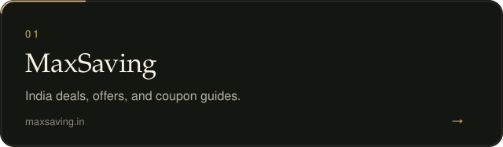
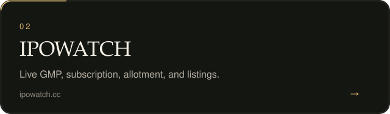
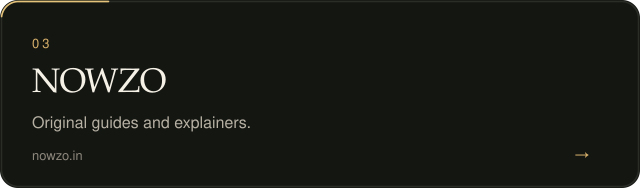
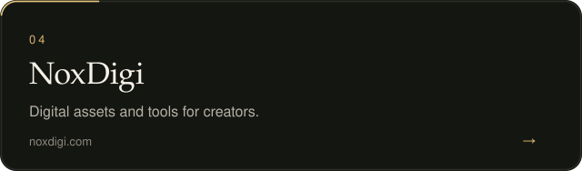
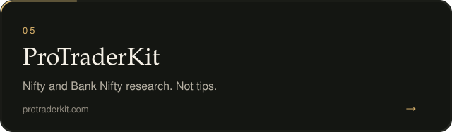
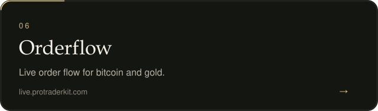

## Selected work

  
  

  
  

  
  

## Practice

I ship the whole product: the public site, the admin, the data, and the Android app when the product needs one.

  <a href="https://noxdigi.com">noxdigi.com</a>

